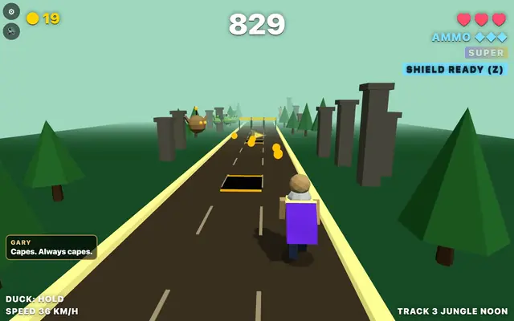
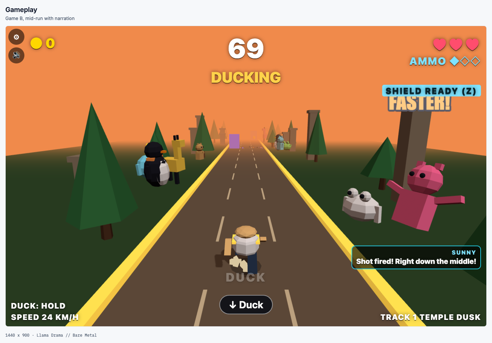
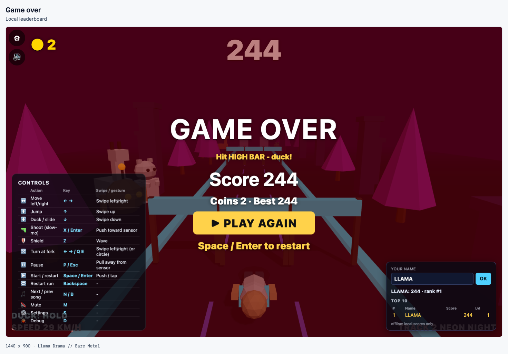
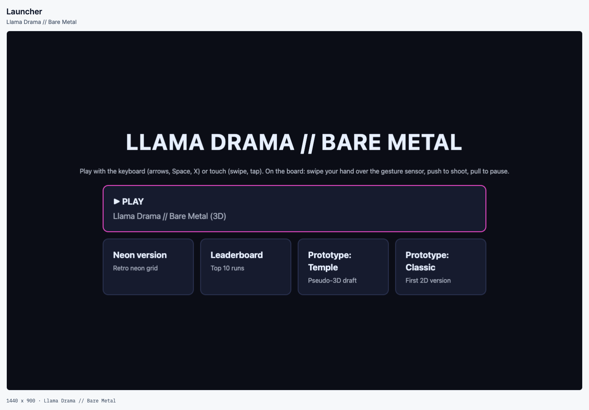
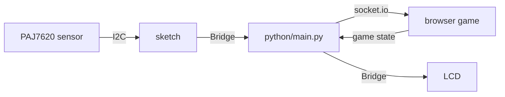

# Llama Drama

An endless runner you play with hand gestures over a gesture sensor on an Arduino UNO Q, or with the keyboard in any browser.

[](https://github.com/itisAliRH/llama-drama/actions/workflows/ci.yml)

**[Play in the browser](https://itisalirh.github.io/llama-drama/)** (keyboard or touch, no install)



[Watch the demo with sound (voices: elevenlabs.io)](docs/media/demo.mp4)

| Mid-run with narration | Game over and local leaderboard | Launcher |
|---|---|---|
|  |  |  |

The pressed-key labels were added for the capture only; they are not part of the game. The demo was recorded with "Super ammo every" set to 20 s in the game settings.

## Features

- 3D runner (three.js) with three lanes, jump, duck or slide, shoot in slow motion, and a shield.
- Lives, coins, ammo, traps that unlock by level, forks where you choose the way, near-miss combos, time-based speed curve.
- Six procedural songs and WebAudio sound effects.
- Narration: two commentators, Gary (sarcastic llama) and Sunny (cheerful robot), plus a crowd that reacts to the run.
- Leaderboard: local in the browser, shared on the board.
- On the board: gestures from a Grove Gesture sensor, and a Grove LCD that shows score, lives and effects.
- Also in the repo: a neon version (`proto/c.html`), a sensor test page, and a recorder for gesture clips.

## Quick start

### In the browser

```sh
npm run dev
```

Open http://127.0.0.1:8000/. No install step is needed for the server. See [docs/web-setup.md](docs/web-setup.md) for keys, options and the Pages deploy.

Keys: arrows to move, jump and duck. Space to start. X to shoot, Z for shield, P to pause, Backspace to restart, M to mute, S for settings.

### On the board

Needs an Arduino UNO Q, a Grove Gesture sensor (PAJ7620) and a Grove LCD RGB Backlight.

```sh
export BOARD_HOST=arduino@<board-ip>
scripts/deploy.sh
```

Then open `http://<board-ip>:7000/`. Wiring, SSH key setup, logs and rollback are in [docs/hardware-setup.md](docs/hardware-setup.md). The board app has no login. Use it on a trusted network only.

## How the gesture controller works

The sensor (PAJ7620) detects nine gestures by itself. The sketch reads them and sends them to the Python app on the board over Bridge. The app forwards them to the browser as moves.

| Gesture | Action | Keyboard |
|---|---|---|
| Swipe left or right | Change lane | Left or Right arrow |
| Swipe up | Jump | Up arrow |
| Swipe down | Duck or slide | Down arrow |
| Push toward the sensor | Shoot, start | X |
| Pull away | Pause | P or Esc |
| Wave | Shield | Z |
| Swipe left or right at a fork | Turn | Left or Right arrow, Q or E |
| Clockwise or anticlockwise circle | Alternative turn right or left | T or R |

Hold a flat hand 5 to 15 cm above the sensor. The sensor rotation and mirror are set in the game settings (S). The default controller is the sensor's built-in gestures. An Edge Impulse model was explored but is not used, see [docs/edge-impulse.md](docs/edge-impulse.md).

## Narration

- Offline clips (default): the browser demo and the board play pre-generated clips from `assets/voice/`. They were made with `scripts/gen_voice.py` from `assets/voice/lines.json`. No key is needed to play.
- Live voice (optional, board only): the board can speak lines built from the running game through ElevenLabs. It needs `data/elevenlabs.key` (or `ELEVENLABS_API_KEY`) and `LIVE_TTS=1` (or `data/live_tts`) in the board app folder, and the "Live voice" switch in the game settings. The key never goes to the browser. Limits: one request per client every 2 s, 20,000 characters per day. It falls back to the clips. Details in [docs/hardware-setup.md](docs/hardware-setup.md).

The audio files are not under the MIT licence. See [Licence](#licence).

## Architecture



Details: [docs/architecture.md](docs/architecture.md).

## Docs

| Page | About |
|---|---|
| [docs/web-setup.md](docs/web-setup.md) | Run in the browser, controls, URL options, Pages deploy |
| [docs/hardware-setup.md](docs/hardware-setup.md) | Parts, wiring, deploy, logs, live narration, rollback |
| [docs/architecture.md](docs/architecture.md) | Components and event flow |
| [docs/edge-impulse.md](docs/edge-impulse.md) | Unfinished model exploration and how to train your own |
| [docs/troubleshooting.md](docs/troubleshooting.md) | Common problems |
| [docs/hackathon/](docs/hackathon/) | Original hackathon documents, kept as written |
| [CONTRIBUTING.md](CONTRIBUTING.md), [SECURITY.md](SECURITY.md), [NOTICE.md](NOTICE.md) | Contributing, security policy, third-party notices |

## Hackathon

Llama Drama was built on 2026-10-10 at the [Bare Metal Hackathon](https://luma.com/7fzrbmox), organised by [HACK//OPS](https://hackops.tech/). The theme was "Build Your Own Arcade". It won the ElevenLabs integration award. The original documents are in [docs/hackathon/](docs/hackathon/).

## Team

- [Alireza Heidari](https://github.com/itisAliRH)
- [Matador1376](https://github.com/Matador1376)
- [AliNoori97](https://github.com/AliNoori97)

## Acknowledgements

Thanks to HACK//OPS for the event, and to the partners and sponsors Arduino, Edge Impulse and ElevenLabs. Narration audio is generated with ElevenLabs (elevenlabs.io). The sensor init table comes from Seeed Studio's Gesture_PAJ7620 library. The game uses three.js and Socket.IO.

This project is not affiliated with Arduino, Edge Impulse, ElevenLabs, Seeed Studio or HACK//OPS.

## Licence

The code and documentation are MIT, see [LICENSE](LICENSE). The audio files in `assets/voice/` were generated with the ElevenLabs free plan. They are not MIT, are for non-commercial use only, and need the attribution "elevenlabs.io". The vendored libraries in `assets/libs/` keep their own licences. See [NOTICE.md](NOTICE.md).
