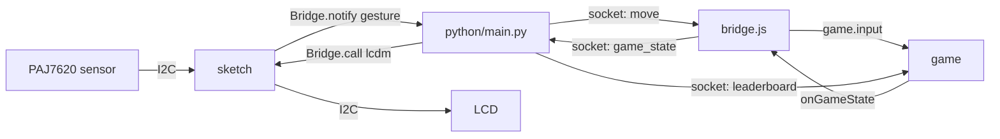

# Architecture

Llama Drama has four parts: a sensor and an LCD on the microcontroller, a Python app on the board's Linux side, and a browser game.

## Components

| Part | Where | Role |
|---|---|---|
| `sketch/sketch.ino` | UNO Q microcontroller | Reads the PAJ7620 over I2C every 50 ms, drives the LCD, talks to Python over Bridge (RPC). |
| `python/main.py` | UNO Q Linux side | Runs the WebUI brick (HTTP and socket.io on port 7000). Forwards gestures to the browser, game state to the LCD, keeps the leaderboard, optional live narration, optional Edge Impulse model. |
| `assets/` | Served by the board, or any static host | The game (`proto/b.html`, 3D, three.js), settings, sound, leaderboard page, sensor and recorder pages. |
| `assets/bridge.js` | Browser | Glue between the game and the board socket. |

## Event flow

Gesture to game:

1. The sketch polls the sensor result registers every 50 ms. On a gesture it calls `Bridge.notify("gesture", move, raw)`.
2. `python/main.py` receives it in `gesture()` and sends a socket `move` event with `{move}` to all browsers.
3. `bridge.js` takes the `move` event. It maps `shoot` to `start` when no run is active, and `wave` to `shield`. Then it calls `window.game.input(move, source)`.
4. `settings.js` wraps `game.input` for gesture input. It applies sensor rotation and mirror, and drops inputs that come faster than the cooldown. Keyboard and touch input skip this.

Game to LCD and leaderboard:

1. The game calls `window.onGameState(state)` on start, on death, on pause, and at most every 500 ms while running.
2. `bridge.js` sends it as the socket event `game_state`.
3. `on_game_state` in `python/main.py` turns it into an LCD mode (idle, running, paused, dead) and calls `Bridge.call("lcdm", ...)` from a worker thread, at most 8 times per second. The sketch draws the screen and sets the backlight.
4. The same event feeds the leaderboard. When a client goes from `running` to `dead`, the run is recorded in `data/leaderboard.json` and the board emits `leaderboard`.

Live narration (optional, board only):

1. The page emits `tts` with `{id, text, who}`.
2. The board checks the limits and calls ElevenLabs. It replies `tts_audio` with `{id, ok, b64}` to the asking client only.
3. If there is no reply within 2.5 s, the page plays the pre-generated clip.

Other socket events (`debug`, `raw`, `record_*`, `set_mode`, `set_player`, `clip_counts`) serve the debug panel, the recorder and the player name. The full list is in `python/main.py`. The page-to-board interface at the time of the hackathon is in `hackathon/contract.md`.

## Gestures

The PAJ7620 reports 9 gestures. The sketch maps them to moves:

| Sensor | Move sent |
|---|---|
| Left, right | `left`, `right` |
| Up, down | `jump`, `duck` |
| Forward (push) | `shoot` |
| Backward (pull) | `pause` (ignored for 1.5 s after a push) |
| Clockwise, anticlockwise | `track`, `track_prev` (turn right, left at a fork) |
| Wave | `wave` (shield) |

## Offline mode

The browser build has no board.

- `bridge.js` skips the socket entirely when the host is `github.io`, the page is on `file://`, or the URL has `?offline`. `window.BM_OFFLINE` is set. It sends nothing.
- With a board that is down, the socket gives up after 5 tries, until the board answers once.
- Input comes from keyboard and touch only. Gesture-specific copy and the live voice settings are hidden.
- The leaderboard and best score use the browser's local storage.
- Narration plays the pre-generated clips from `assets/voice/`. There is no live voice.
- The sensor and recorder pages need a board, so the launcher hides them.
